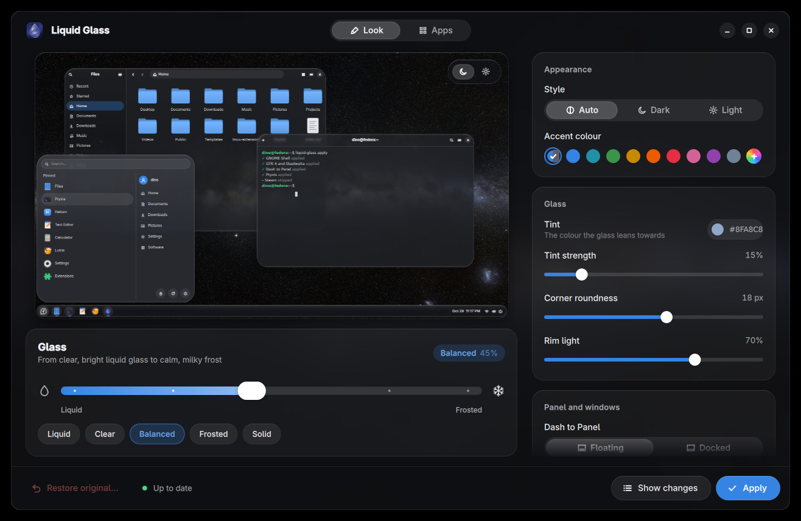

<h1 align="center">
  <br>
  Fedora Glass
</h1>

<p align="center">A glass look for the whole Fedora GNOME desktop, with an app to tune it from liquid to frosted.</p>

<p align="center"></p>

Made for **Fedora 44 with GNOME 50**, and ready for GNOME 51 (Fedora 45). It draws its own glass, so you don't need Blur my Shell.

## Install

```sh
sudo dnf install https://github.com/djshiye/fedora-glass/releases/latest/download/fedora-glass.noarch.rpm
```

1. Open **Fedora Glass** from the app grid.
2. Pick a look with the **Liquid ↔ Frosted** slider and press **Apply**.
3. Restart your PC once, so GNOME loads the glass. From then on, changes show up live.

The package adds its own dnf repository, so updates then come with the rest of your system through
`sudo dnf upgrade`. The repository is built by this project's GitHub Actions from each release,
after checking the RPMs against the release's `SHA256SUMS`, and served over HTTPS from GitHub Pages.
The packages are not GPG-signed. After an upgrade Fedora Glass brings your look up to date by itself, with your own settings, and
the new glass shows from your next restart. No need to press Apply.

**Had Liquid Glass?** Fedora Glass is its new name. Run `sudo dnf upgrade` twice: the first one
updates Liquid Glass and adds the new repository, the second one swaps the package for
`fedora-glass`. If dnf finds nothing new, run the install command above once instead. Either way
your settings and your look stay as they are. Then restart your PC: Fedora Glass updates your look
by itself, and the themes and the Shell extension carry the new name.

## Undo or remove

- **Restore original** in the app puts your desktop back exactly as it was before the first Apply.
- To remove it completely, run these as your normal user:

  ```sh
  fedora-glass revert
  sudo dnf remove fedora-glass
  ```

  Removing it also puts the normal login screen back if you turned on glass there.

  Run `fedora-glass revert` first: the glass lives in your home folder, so `dnf remove` on its own
  takes the app away but leaves the glass on. Your Fedora Glass settings stay in
  `~/.config/liquid-glass`, so a later install remembers them; delete that folder for a clean slate.

## Blur my Shell

You can uninstall it. Fedora Glass covers what Blur my Shell did (the panel, menus, overview and app
windows) with its own extension. If Blur my Shell is still installed, Fedora Glass turns off the
parts that would blur the same things twice, and **Restore original** turns them back on.

```sh
gnome-extensions uninstall blur-my-shell@aunetx   # or: sudo dnf remove gnome-shell-extension-blur-my-shell
```

## Straight to the desktop

GNOME starts on your desktop instead of the Activities overview (**Start on the desktop**, on by
default). **Turn off the overview** goes further: the hot corner, the Super key and the three-finger
swipe stop opening Activities, and you start apps from ArcMenu or Dash to Panel. Without ArcMenu the
app grid still opens, so there is always a way to start an app. If Dash to Panel or Just Perfection
is installed, their own start-up option is set to match, and turning ours off puts theirs back.

## What it themes

GNOME Shell, Dash to Panel, ArcMenu, GTK 4 and libadwaita apps (Nautilus included), GTK 3 apps,
Flatpak apps, Ptyxis and GNOME Terminal, Qt apps (through Kvantum), btop, micro, Discord (Vencord),
VS Code, Obsidian, qBittorrent, Prism Launcher, Brave, Helium, Clipperino, RGBeast and Wheelguard.
The app's **Apps** page lists every part, shows which you have installed, and has a switch for each.
Apply also gives the lock screen a glass sheet; you can turn it off under **Lock screen**.

The login screen is opt in: **Use glass on the login screen** (under Lock screen) asks for your
password, then gives it a glow in your tint colour with glass panes for your name and password.
**Put the normal login screen back** undoes it exactly, and GNOME updates undo it by themselves.

<p align="center"></p>

## How the glass works

Each panel and menu sits on a live, blurred copy of what's behind it, seen through a slab of glass
with a rounded edge. The shader follows real optics:

- **Refraction:** light bends where it enters the curved edge (Snell's law), so the rim magnifies
  what's behind it while the flat middle stays true.
- **Dispersion:** each colour bends slightly differently, so the edge splits light into a faint
  rainbow.
- **Reflection:** the glass reflects about 4% of light head-on and almost all of it at grazing
  angles (Fresnel). The edge mirrors what really lies beyond it, the wallpaper and your windows, so
  it changes as they move. No outline or glow is drawn on.
- **Colour bleed:** coloured icons light up the glass around them, and their light comes out again
  at the nearest edge, so a blue icon tints the glass near it. White and grey text cast nothing, so
  the glass never turns milky.
- **Light that follows you:** the edge light turns towards the pointer when it comes near, and
  menus settle with a small spring as they open. Both stop when you stop, so idle glass costs
  nothing, and **Reduce animation** turns both off.
- **Absorption:** light slanting through the edge crosses more glass, so the edge is a shade darker
  and greener (Beer-Lambert).

The edge shape builds on Kyant's [AndroidLiquidGlass](https://github.com/Kyant0/AndroidLiquidGlass).

## Safe by design

- It runs as you: no root, no network access, and it changes only your own settings. The one
  exception is the opt-in login screen glass, which asks for your password. Its small helper takes
  only three colours or numbers, changes only the login screen's part of GNOME Shell's theme file,
  checks every other part stays byte for byte the same, and keeps the original to put back.
- Every file and setting is backed up before its first change. **Show changes** lists everything
  before **Apply** touches it.

## Command line

```sh
fedora-glass                     # open the app
fedora-glass apply --frost 0.3   # 0 = liquid, 1 = frosted
fedora-glass status              # which parts are available
fedora-glass revert              # restore the original look
```

## From source

```sh
git clone https://github.com/djshiye/fedora-glass && cd fedora-glass
./install.sh      # installs to your home folder; ./uninstall.sh removes it
```

App developers can match the desktop's colours with [docs/TOKENS.md](docs/TOKENS.md).

## License

[MIT](LICENSE). The edge shape from AndroidLiquidGlass is Apache 2.0, see
[THIRD-PARTY-NOTICES.md](THIRD-PARTY-NOTICES.md).
