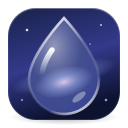
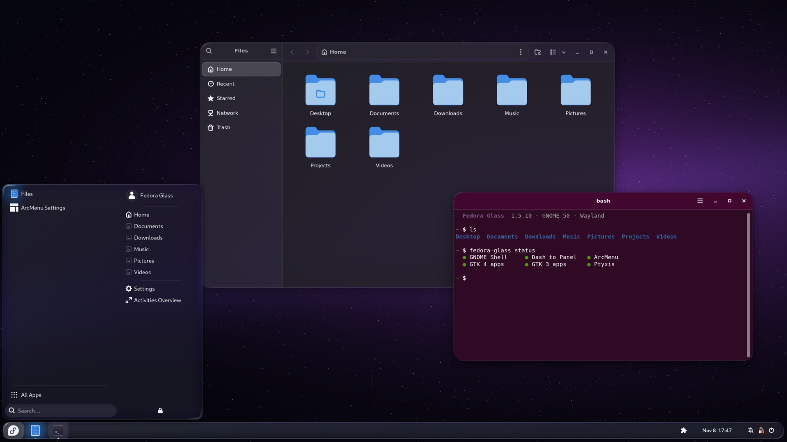
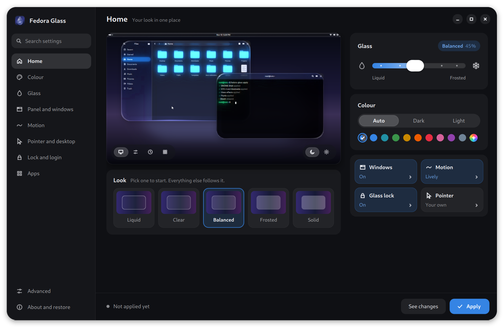
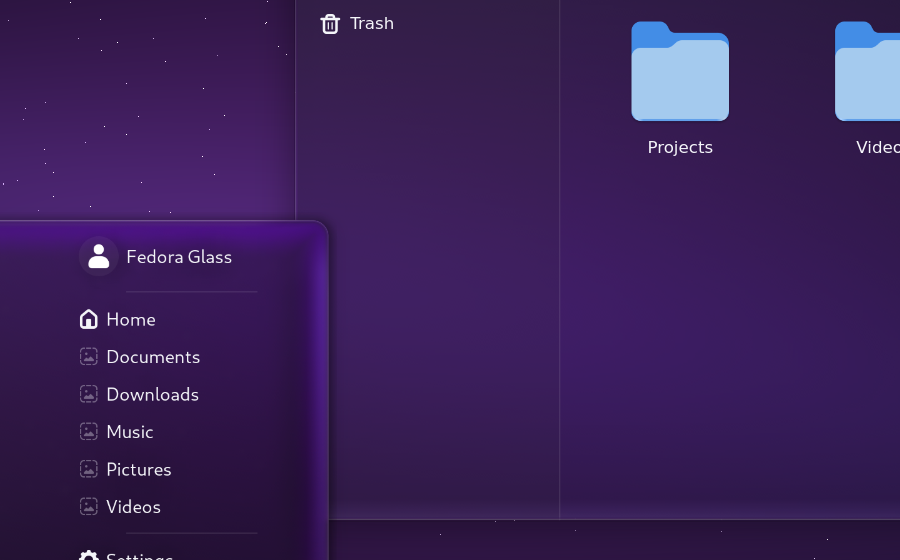

<h1 align="center">
  <br>
  Fedora Glass
</h1>

<p align="center">A glass look for the whole GNOME desktop, with an app to tune it from liquid to frosted.</p>

<p align="center"></p>

Made for **GNOME 50 and 51** on **Fedora** (44, 45), **Ubuntu** (26.04 LTS, 26.10) and **Arch Linux**.

## Install

Pick your Linux. Each one installs the same app, and from then on your normal system update brings
new versions.

**Fedora**

```sh
sudo dnf install https://github.com/djshiye/fedora-glass/releases/latest/download/fedora-glass.noarch.rpm
```

**Ubuntu**

```sh
wget -O /tmp/fedora-glass.deb https://github.com/djshiye/fedora-glass/releases/latest/download/fedora-glass.deb
sudo apt install /tmp/fedora-glass.deb
```

**Arch Linux**

```sh
curl -fsSLo /tmp/fedora-glass.key https://djshiye.github.io/fedora-glass/RPM-GPG-KEY-fedora-glass
sudo pacman-key --add /tmp/fedora-glass.key
sudo pacman-key --lsign-key D49A308168257FDBF9D5AE14BD1AC1C6F56A7252
printf '\n[fedora-glass]\nSigLevel = Required DatabaseRequired\nServer = https://djshiye.github.io/fedora-glass/arch\n' | sudo tee -a /etc/pacman.conf
sudo pacman -Syu fedora-glass
```

Then:

1. Open **Fedora Glass** from the app grid.
2. Pick a look with the **Liquid ↔ Frosted** slider and press **Apply**.
3. Restart your PC once, so GNOME loads the glass.

**Updates** come with the rest of your system: `sudo dnf upgrade` on Fedora, `sudo apt update && sudo apt upgrade`
on Ubuntu, `sudo pacman -Syu` on Arch. They are served from GitHub Pages, and every package and
repository index is signed with the maintainer's own OpenPGP key
([how the signing works](docs/SIGNING.md)). The Fedora and Ubuntu packages bring the key with them; on
Arch the `--lsign-key` line above trusts only the key with that fingerprint, so a swapped key file
is refused. Fedora asks you to accept the key once, on the first update.

## Works with

Fedora Glass is made to work with **Dash to Panel** and **ArcMenu** (or Spawn), and themes them to
match. It draws its own glass, so if you use **Blur my Shell** you can simply remove it. While it is
still installed, Fedora Glass switches off the parts that would blur the same things twice.

It also themes GTK 3, GTK 4 and libadwaita apps (Files included), Flatpak apps, Ptyxis and GNOME
Terminal, Qt apps (through Kvantum), the lock screen and, if you opt in, the login screen. The app's
**Apps** page lists every part, shows which ones you have, and has a switch for each.

<p align="center"></p>

## Undo or remove

- **Restore original** in the app puts your desktop back exactly as it was before the first Apply.
- **Remove Fedora Glass…** (at the bottom of the Look page), or `sudo dnf remove fedora-glass`
  (Ubuntu: `sudo apt remove fedora-glass`, Arch: `sudo pacman -R fedora-glass`), restores your
  original look and then removes the app.

## How the glass works

The glass is modelled on how real glass behaves, using the physics of light that optics textbooks
describe, not a flat blur with a glow painted on. Each panel, menu and window sits on a live,
blurred copy of what's behind it, seen through a slab of glass with a rounded edge:

- **Refraction:** light bends where it enters the curved edge (Snell's law), so the rim magnifies
  what's behind it while the flat middle stays true.
- **Dispersion:** each colour bends by a slightly different amount, so the edge splits light into a
  faint rainbow.
- **Reflection:** the glass reflects about 4 % of light head-on and much more at grazing angles
  (Fresnel), so the rim catches light the way a real pane does.
- **Absorption:** light crossing more glass near the edge comes out a shade darker (Beer-Lambert).

<p align="center"></p>

Idle glass costs nothing, and **Reduce animation** turns the motion off.

The edge shape builds on Kyant's [AndroidLiquidGlass](https://github.com/Kyant0/AndroidLiquidGlass).

## Safe by design

- It runs as you, with no network access, and changes only your own settings. The one exception is
  the opt-in login screen glass, which asks for your password and changes only the login screen's
  part of GNOME Shell's theme.
- Every file and setting is backed up before its first change, and **Show changes** lists
  everything before **Apply** touches it.

## Command line

```sh
fedora-glass                     # open the app
fedora-glass apply --frost 0.3   # 0 = liquid, 1 = frosted
fedora-glass status              # which parts are available
fedora-glass revert              # restore the original look
```

## From source

```sh
git clone https://github.com/djshiye/fedora-glass && cd fedora-glass
./install.sh      # installs to your home folder; ./uninstall.sh removes it
```

App developers can match the desktop's colours with [docs/TOKENS.md](docs/TOKENS.md).

## License

[MIT](LICENSE). The edge shape from AndroidLiquidGlass is Apache 2.0, see
[THIRD-PARTY-NOTICES.md](THIRD-PARTY-NOTICES.md).
