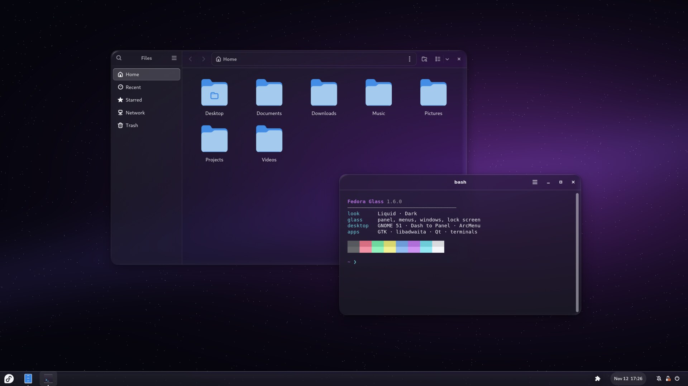
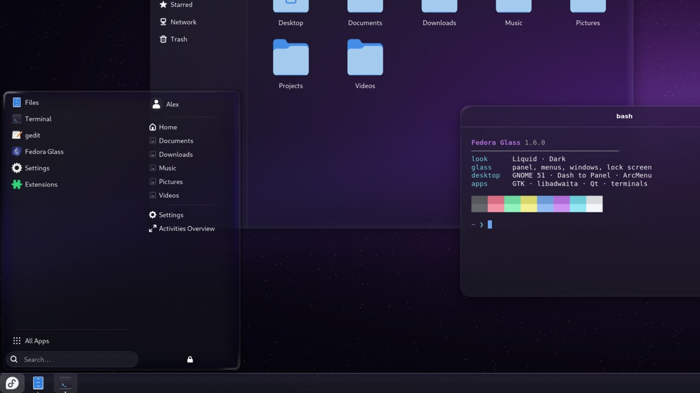
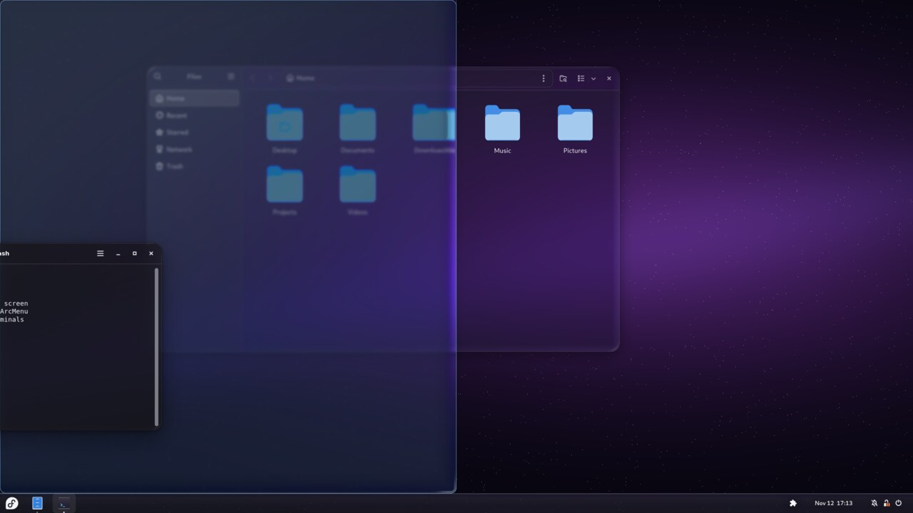
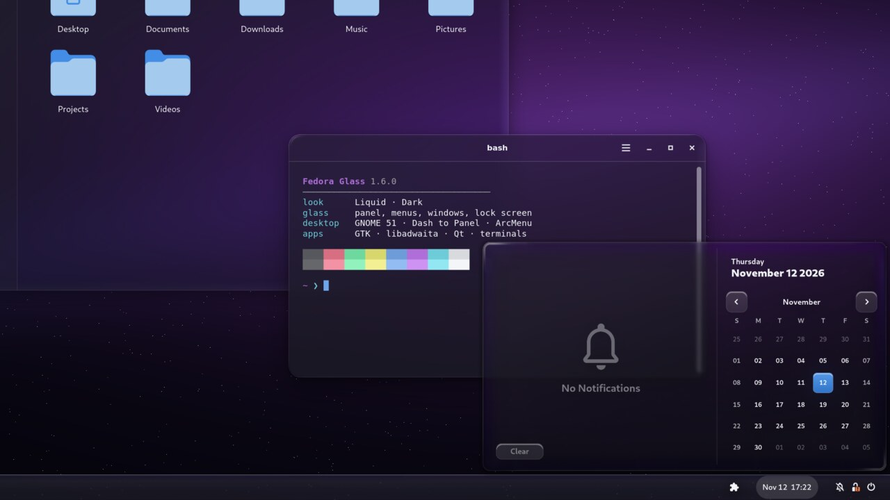
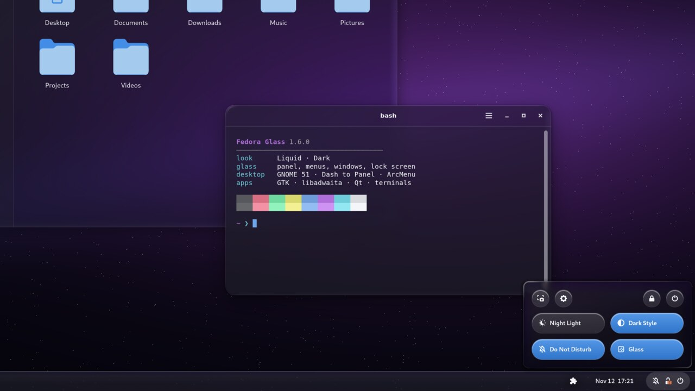
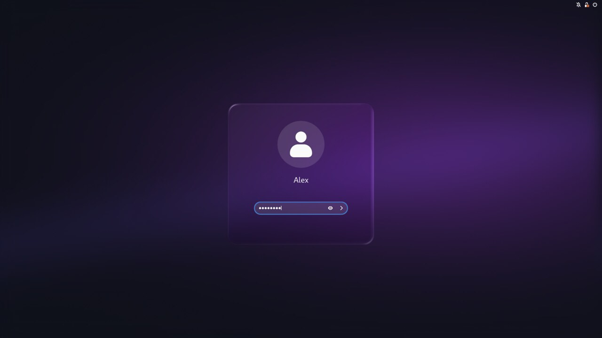

<h1 align="center">
  <br>
  Fedora Glass
</h1>

<p align="center">A glass look for the whole GNOME desktop, with an app to tune it from liquid to frosted.</p>

<!-- Demo video: paste the GitHub video link on the line below this comment, then delete the demo.webp line. -->

https://github.com/user-attachments/assets/e523a812-8b07-4e61-8f05-ac63be60f7a3

<p align="center">Made for <b>GNOME 50 and 51</b> on <b>Fedora</b> (44, 45), <b>Ubuntu</b> (26.04 LTS, 26.10) and <b>Arch Linux</b>.</p>

<table>
  <tr>
    <td width="50%"><br><sub><b>Your desktop in glass.</b> Apps, terminal and taskbar.</sub></td>
    <td width="50%"><br><sub><b>Menus made of glass.</b> ArcMenu and every pop-up.</sub></td>
  </tr>
  <tr>
    <td><br><sub><b>Glass snap preview.</b> New in 1.6.</sub></td>
    <td><br><sub><b>Calendar and notifications.</b> The terminal shows through.</sub></td>
  </tr>
  <tr>
    <td><br><sub><b>Quick Settings.</b> With a Glass toggle.</sub></td>
    <td><br><sub><b>Lock screen.</b> A glass card for your password.</sub></td>
  </tr>
</table>

## Install

Pick your Linux. Each one installs the same app, and from then on your normal system update brings
new versions.

**Fedora**

```sh
k=$(mktemp) && curl -fsSLo "$k" https://djshiye.github.io/fedora-glass/RPM-GPG-KEY-fedora-glass &&
{ [ "$(gpg --show-keys --with-colons "$k" | awk -F: '$1 == "pub" { getline; print $10 }')" = D49A308168257FDBF9D5AE14BD1AC1C6F56A7252 ] || { echo "Stopped: not the Fedora Glass key."; false; }; } &&
sudo install -Dm644 "$k" /etc/pki/rpm-gpg/RPM-GPG-KEY-fedora-glass && sudo rpm --import "$k" &&
printf '[fedora-glass-setup]\nname=Fedora Glass\nbaseurl=https://djshiye.github.io/fedora-glass/rpms/\nincludepkgs=fedora-glass\ngpgcheck=1\nrepo_gpgcheck=1\ngpgkey=file:///etc/pki/rpm-gpg/RPM-GPG-KEY-fedora-glass\nmetadata_expire=1h\n' | sudo tee /etc/yum.repos.d/fedora-glass-setup.repo >/dev/null &&
sudo dnf install fedora-glass
sudo rm -f /etc/yum.repos.d/fedora-glass-setup.repo
```

**Ubuntu**

```sh
k=$(mktemp) && wget -qO "$k" https://djshiye.github.io/fedora-glass/RPM-GPG-KEY-fedora-glass &&
{ [ "$(gpg --show-keys --with-colons "$k" | awk -F: '$1 == "pub" { getline; print $10 }')" = D49A308168257FDBF9D5AE14BD1AC1C6F56A7252 ] || { echo "Stopped: not the Fedora Glass key."; false; }; } &&
sudo install -Dm644 "$k" /usr/share/keyrings/fedora-glass.asc &&
printf 'Types: deb\nURIs: https://djshiye.github.io/fedora-glass/apt/\nSuites: ./\nSigned-By: /usr/share/keyrings/fedora-glass.asc\n' | sudo tee /etc/apt/sources.list.d/fedora-glass-setup.sources >/dev/null &&
sudo apt update && sudo apt install fedora-glass
sudo rm -f /etc/apt/sources.list.d/fedora-glass-setup.sources
```

**Arch Linux**

```sh
k=$(mktemp) && curl -fsSLo "$k" https://djshiye.github.io/fedora-glass/RPM-GPG-KEY-fedora-glass &&
{ [ "$(gpg --show-keys --with-colons "$k" | awk -F: '$1 == "pub" { getline; print $10 }')" = D49A308168257FDBF9D5AE14BD1AC1C6F56A7252 ] || { echo "Stopped: not the Fedora Glass key."; false; }; } &&
sudo pacman-key --add "$k" &&
sudo pacman-key --lsign-key D49A308168257FDBF9D5AE14BD1AC1C6F56A7252 &&
{ grep -q '^\[fedora-glass\]' /etc/pacman.conf || printf '\n[fedora-glass]\nSigLevel = Required DatabaseRequired\nServer = https://djshiye.github.io/fedora-glass/arch\n' | sudo tee -a /etc/pacman.conf >/dev/null; } &&
sudo pacman -Syu fedora-glass
```

Then:

1. Open **Fedora Glass** from the app grid.
2. Pick a look with the **Liquid ↔ Frosted** slider and press **Apply**. Your apps change straight
   away.
3. Restart your PC once. The glass on the panel and menus appears after the restart, and the app
   offers a **Restart** button so you don't have to look for it.

**Updates** come with the rest of your system: `sudo dnf upgrade` on Fedora, `sudo apt update && sudo apt upgrade`
on Ubuntu, `sudo pacman -Syu` on Arch. They are served from GitHub Pages, and every package and
repository index is signed with the maintainer's own OpenPGP key
([how the signing works](docs/SIGNING.md)). The blocks above trust only the key with the fingerprint
`D49A 3081 6825 7FDB F9D5 AE14 BD1A C1C6 F56A 7252`, so a swapped key file is refused. If dnf asks you
to accept the key, check that it shows that fingerprint (dnf writes it without spaces:
`D49A308168257FDBF9D5AE14BD1AC1C6F56A7252`) and answer `y`.

You don't need to press **Apply** after an update. The next time you log in (or restart), Fedora
Glass puts your look in again with the new version's fixes, using the settings of your last
Apply. One restart is enough, also when GNOME Software installs the update while you restart.
If you used **Restore original**, an update leaves your desktop alone. Glass on the login
screen is brought up to date by the update itself, without asking for your password.

## Works with

Fedora Glass works on **GNOME as it comes**: the top bar, the overview and its dash, Quick Settings,
the calendar and your apps all get glass, with no extensions to install first.

If you use **Dash to Panel**, **Dash to Dock** or **Ubuntu Dock**, **ArcMenu** or **Spawn**, it
themes those to match as well. The app looks at what you have and only shows the options that apply
to your desktop.

It draws its own glass, so if you use **Blur my Shell** you can simply remove it. While it is still
installed, Fedora Glass switches off the parts that would blur the same things twice.

It also themes GTK 3, GTK 4 and libadwaita apps (Files included), Flatpak apps, Ptyxis, GNOME
Terminal, Kitty, Ghostty, Alacritty, Foot and WezTerm, Qt apps (through Kvantum), the lock screen and, if you opt in, the login screen. The app's
**Apps** page lists every part, shows which ones you have, and has a switch for each.

<p align="center"></p>

## Undo or remove

- **Restore original** (in the app, under About and restore) puts your desktop back exactly as it was before the first Apply.
- **Remove Fedora Glass…** (under About and restore), or `sudo dnf remove fedora-glass`
  (Ubuntu: `sudo apt remove fedora-glass`, Arch: `sudo pacman -R fedora-glass`), restores your
  original look and then removes the app.
- On Arch, the install also added a repository and a key. To take those out too, delete the
  `[fedora-glass]` block (three lines) from `/etc/pacman.conf`, then run
  `sudo pacman-key --delete D49A308168257FDBF9D5AE14BD1AC1C6F56A7252`.

## If the glass doesn't show

- **Restart your PC once.** GNOME only starts the glass when your PC starts. Until then your apps are
  themed but the panel and menus are not, and the app says **Restart to finish**.
- **Open the Apps page.** It lists every part and whether it is switched on. **Check again** looks
  for apps and extensions you installed after the last Apply.
- **Look for a banner at the bottom of the app.** If the glass kept failing it pauses itself, and
  **Turn glass back on** starts it again. If another theme replaced the look, **Re-apply** brings it
  back.
- Still stuck? **Restore original** puts everything back, and an
  [issue](https://github.com/djshiye/fedora-glass/issues) with your Linux and GNOME version helps.

## How the glass works

The glass is modelled on how real glass behaves, using the physics of light that optics textbooks
describe, not a flat blur with a glow painted on. Each panel, menu and window sits on a live,
blurred copy of what's behind it, seen through a slab of glass with a rounded edge:

- **Refraction:** light bends where it enters the curved edge (Snell's law), so the rim magnifies
  what's behind it while the flat middle stays true.
- **Dispersion:** each colour bends by a slightly different amount, so the edge splits light into a
  faint rainbow.
- **Reflection:** the glass reflects about 4 % of light head-on and much more at grazing angles
  (Fresnel), so the rim catches light the way a real pane does.
- **Absorption:** light crossing more glass near the edge comes out a shade darker (Beer-Lambert).

<p align="center"></p>

Idle glass costs nothing, and **Reduce animation** turns the motion off.

The edge shape builds on Kyant's [AndroidLiquidGlass](https://github.com/Kyant0/AndroidLiquidGlass).

## Safe by design

- It runs as you, with no network access, and changes only your own settings. The one exception is
  the opt-in login screen glass, which asks for your password and changes only the login screen's
  part of GNOME Shell's theme.
- Every file and setting is backed up before its first change, and **See changes** lists
  everything before **Apply** touches it.

## Command line

```sh
fedora-glass                     # open the app
fedora-glass apply --frost 0.3   # 0 = liquid, 1 = frosted
fedora-glass status              # which parts are available
fedora-glass revert              # restore the original look
```

## From source

```sh
git clone https://github.com/djshiye/fedora-glass && cd fedora-glass
./install.sh      # installs to your home folder; ./uninstall.sh removes it
```

App developers can match the desktop's colours with [docs/TOKENS.md](docs/TOKENS.md).

## License

[MIT](LICENSE). The edge shape from AndroidLiquidGlass is Apache 2.0, see
[THIRD-PARTY-NOTICES.md](THIRD-PARTY-NOTICES.md).
